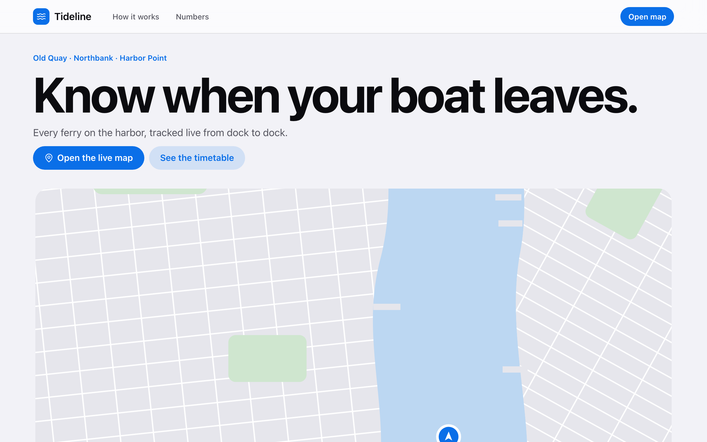
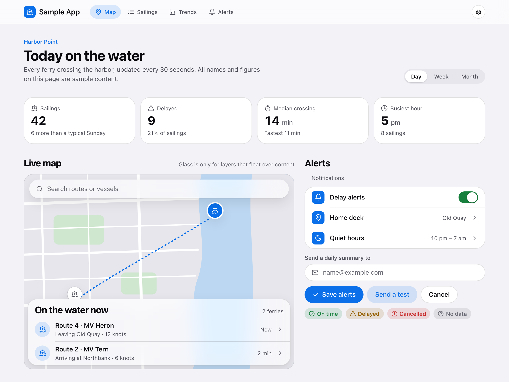
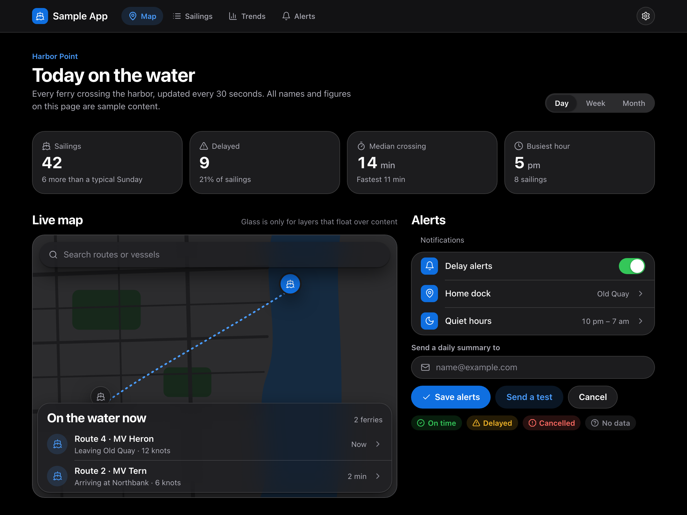
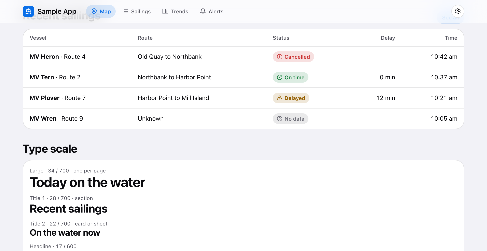
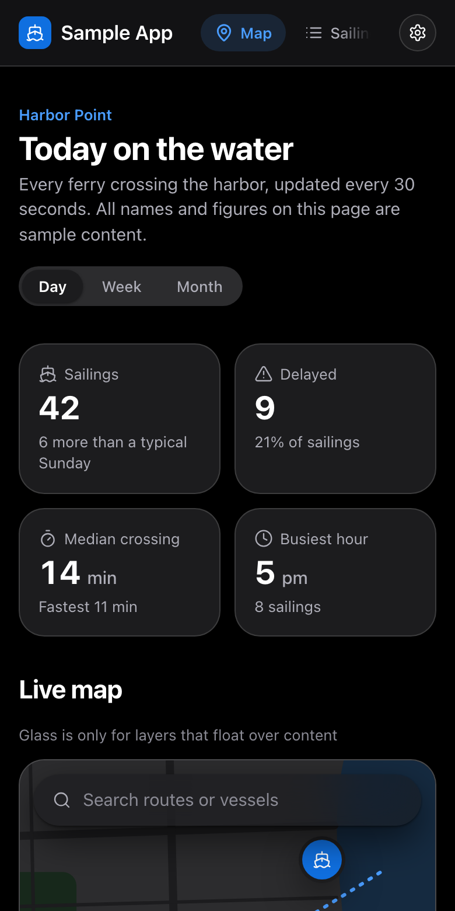
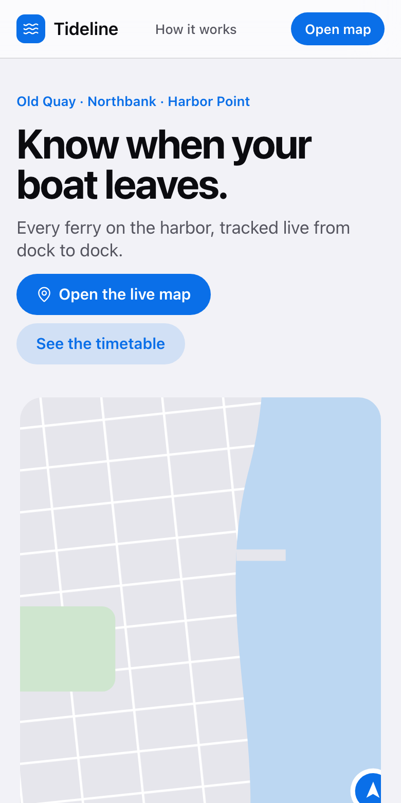
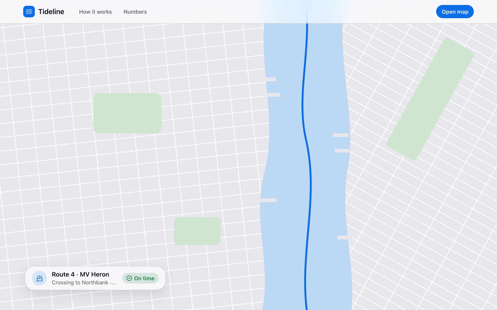
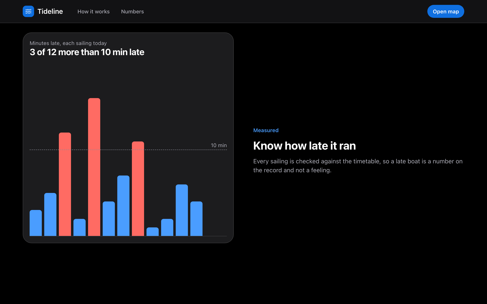
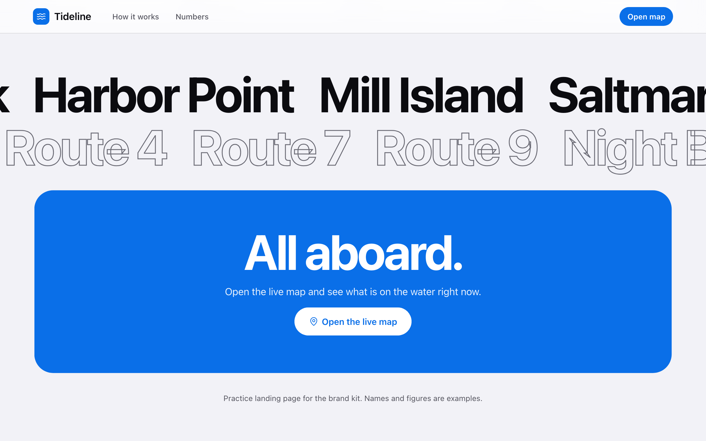

# brand-kit

One visual system for every app I build: type, colour, spacing, icons and
components, with light and dark themes that follow the system setting. Calm,
map-app-style screens for the product, and scroll-driven motion for landing pages.



The screenshots use a made-up ferry tracker called Tideline. All names and
figures in them are sample content.

## The look

| | |
|---|---|
| **Typeface** | SF on Apple devices, Inter everywhere else |
| **Icons** | [Lucide](https://lucide.dev), 1.75 stroke |
| **Corners** | 22px cards, pill-shaped controls |
| **Surfaces** | Solid cards with a hairline edge; glass only for layers that float |
| **Colour** | Cool neutrals, one deep blue accent, three status colours |
| **Themes** | Light and dark, chosen by the system |

## App screens

Every component on one page, in both themes. Open [`reference.html`](reference.html) to see it live.

| Light | Dark |
|---|---|
|  |  |

Tables, status pills and the type scale:



On a phone:

| App screen | Landing page |
|---|---|
|  |  |

## Landing pages

App screens stay still. Landing pages can add the motion layer, where
everything moves with the scroll. Open [`landing.html`](landing.html) and scroll slowly.

The hero map grows from a rounded card to the full screen while a route draws itself:



A pinned visual changes while the text beside it scrolls:



Large words slide past, and the closing panel grows into place:



With reduced motion turned on, the same page is static and complete.

## What's in the box

| File | What it is |
|---|---|
| [`tokens.css`](tokens.css) | The source of truth: colour, type, spacing, radius and shadow, for light and dark |
| [`components.css`](components.css) | `bk-` classes built only from the tokens: navbar, buttons, cards, lists, pills, fields, tables |
| [`tailwind.css`](tailwind.css) | Maps the tokens to Tailwind v4 utilities |
| [`motion.css`](motion.css), [`motion.js`](motion.js) | Scroll-driven effects, for landing pages only |
| [`BRAND.md`](BRAND.md) | The rules, with tables of what to use where. Written for people and coding agents |
| [`reference.html`](reference.html) | Every app component on one page |
| [`landing.html`](landing.html) | A practice landing page using the motion layer |
| [`explorer/`](explorer/) | The tool used to choose the direction |

## Use it in a project

Install from GitHub:

```sh
npm install github:kthorburn/brand-kit
```

Import the tokens before your own styles, and the components if you want the ready-made classes:

```css
@import "brand-kit/tokens.css";
@import "brand-kit/components.css";
```

With Tailwind v4, add the bridge to get utilities such as `bg-surface`, `text-text-2` and `rounded-card`:

```css
@import "tailwindcss";
@import "brand-kit/tokens.css";
@import "brand-kit/tailwind.css";
```

Load Inter at weights 400 to 700 for devices that do not have SF, and use
`lucide-react` (or any Lucide package) for icons.

Then point the project's `CLAUDE.md` or `AGENTS.md` at the rules, so coding
agents follow them:

```md
Follow the design rules in node_modules/brand-kit/BRAND.md for all UI work.
```

### Themes

Do nothing and the theme follows the system. To offer a manual switch, set
`data-theme="light"` or `data-theme="dark"` on `<html>`.

### Landing pages

Add `motion.css` and `motion.js`, then opt in with attributes:

```html
<section data-bk-progress>
  <p class="bk-statement" data-bk-words>This paragraph fills in word by word.</p>
</section>
<div class="bk-card" data-bk-reveal>This card rises into place once.</div>
```

Any element with `data-bk-progress` gets a CSS variable `--p` that runs from 0
to 1 as it scrolls past. Each effect is CSS built on that number, so a new one
needs no new JavaScript. The full list is in section 8 of [`BRAND.md`](BRAND.md).

## Working on the kit

Open `reference.html` or `landing.html` in a browser; they load the CSS files
next to them. Change a token and both pages change.

The explorer has a build step, because it inlines three icon sets:

```sh
cd explorer && npm install && python3 build.py
```

## License

[MIT](LICENSE). Use it, change it, ship it.

## Credits

[Inter](https://rsms.me/inter/) is licensed under the SIL Open Font License.
[Lucide](https://lucide.dev) is licensed under ISC. The explorer also previews
[Phosphor](https://phosphoricons.com) and [Tabler](https://tabler.io/icons) icons, both MIT.
